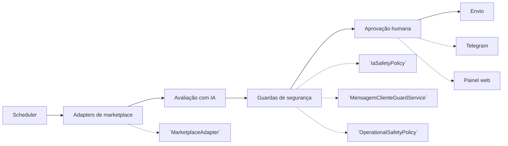

# FreelasAtende


Esta é a edição pública do FreelasAtende. Para obter o código, use `git clone https://github.com/vitorcamillo/freelasAtende.git`. Consulte [LICENSE](LICENSE) e [CONTRIBUTING.md](CONTRIBUTING.md). No Freelancer.com.br, a descoberta consulta a listagem pública e pode aguardar passivamente a verificação do Cloudflare no Chrome residente; a inbox requer cookies importados manualmente. O projeto não contorna desafios de verificação.

Central que monitora marketplaces de freelance (99Freelas, Workana, Upwork, Freelancer.com e Freelancer.com.br), descobre projetos novos, avalia a aderência de cada oportunidade com IA, gera rascunhos de resposta e de proposta e só envia ao cliente depois de aprovação humana via Telegram ou pelo painel web.

## Principais funcionalidades

- Descoberta periódica de projetos nos marketplaces configurados.
- Sincronização de inbox e conversas por plataforma.
- Avaliação de aderência de projetos com IA plugável.
- Geração de rascunhos de perguntas, mensagens e propostas.
- Aprovação humana obrigatória antes de qualquer envio ao cliente.
- Aprovação e operação pelo Telegram e pelo painel web.
- Agendamento de varreduras com pausa e retomada.
- Registro de interações, clientes, projetos e propostas no banco.
- Política de segurança que bloqueia contato externo e promessas indevidas.
- Guarda de mensagens que valida tom, tamanho e conteúdo antes do envio.
- Redação automática de segredos nos logs operacionais.
- Modo de simulação para operar sem escrita real nos marketplaces.
- Suporte a H2, MySQL e PostgreSQL por profiles do Spring.

## Stack

| Camada | Tecnologia |
| --- | --- |
| Linguagem | Java 17 |
| Framework | Spring Boot 3.2.5 |
| Web | Spring Web |
| Cliente HTTP reativo | Spring WebFlux |
| Persistência | Spring Data JPA |
| Validação | Spring Validation |
| Interface web | Thymeleaf |
| Bancos | H2, MySQL, PostgreSQL |
| JSON | Jackson |
| Parse HTML | Jsoup |
| Telegram | TelegramBots |
| Automação de navegador | JavaDriverless (Chrome via CDP) |
| IA plugável | `IaProvider` e `IaProviderFactory` (openai, ollama, lmstudio, custom, openrouter, codex) |
| Testes | JUnit 5 |
| Cobertura | JaCoCo |
| Mutação | PIT |
| Build | Maven |
| Deploy | Docker |

## Arquitetura



- `controller`: expõe o painel web, o controle operacional e as APIs de consulta.
- `scheduler`: executa a varredura periódica de projetos e a sincronização de inbox.
- `config`: centraliza a criação de provedores de IA e as configurações da aplicação.
- `policy`: concentra a política operacional, incluindo aprovação humana e simulação.
- `service/interfaceServico`: define os contratos, como `MarketplaceAdapter` e `IaProvider`.
- `service/impl`: implementa um adapter por marketplace, a avaliação com IA e o fluxo de atendimento.
- `model`: contém entidades, DTOs e enums, incluindo a identificação da plataforma.
- `repository`: acessa o banco com Spring Data JPA.
- `util`: reúne apoios transversais, como `IaSafetyPolicy` e `RedatorSegredos`.

Decisões principais:

- Um adapter por plataforma, com `MarketplaceCapabilities` declarando apenas o que foi validado.
- Aprovação humana obrigatória antes de enviar qualquer mensagem ao cliente.
- Logs operacionais passam por `RedatorSegredos` antes de chegar ao painel.
- Escrita real desligada por padrão, com simulação controlada por variáveis de ambiente.

## Como rodar localmente

Pré-requisitos:

- JDK 17 ou superior.
- Maven 3.9 ou superior.

Copie o arquivo de exemplo de variáveis para o arquivo de ambiente local e preencha os valores:

```bash
cp .env.example .env
```

Variáveis principais a preencher no `.env`:

- `FREELAS_EMAIL`
- `FREELAS_PASSWORD`
- `WORKANA_WORKER_SLUG`
- `UPWORK_EMAIL`
- `UPWORK_PASSWORD`
- `UPWORK_SECURITY_ANSWER`
- `FREELANCER_EMAIL`
- `FREELANCER_PASSWORD`
- `FREELANCERBR_EMAIL`
- `FREELANCERBR_PASSWORD`
- `TELEGRAM_BOT_TOKEN`
- `TELEGRAM_CHAT_ID`
- `IA_PROVIDER`
- `IA_MODEL`
- `IA_BASE_URL`
- `MARKETPLACES_ENABLED`
- `SPRING_PROFILES_ACTIVE`
- `DB_URL`
- `DB_USERNAME`
- `DB_PASSWORD`

Suba a aplicação com o profile local em H2:

```bash
mvn spring-boot:run -Dspring-boot.run.profiles=local-h2
```

Para operar sem nenhum envio real, mantenha o modo seguro com:

- `REAL_WRITE_ENABLED`
- `REAL_WRITE_SIMULATE`
- `TELEGRAM_SIMULATE`

Com `REAL_WRITE_ENABLED` desligado, nada é enviado aos marketplaces. Com `REAL_WRITE_SIMULATE` ligado, o fluxo registra envio simulado após a aprovação humana.

Acesse o painel em:

```text
http://localhost:8080/dashboard
```

Docker (opcional):

```bash
docker build -t freelas-atende .
```

## Sessões e login nas plataformas

| Plataforma | Como a sessão é obtida |
|---|---|
| 99Freelas | Cookies importados manualmente. O login pelo navegador automatizado só preenche credenciais e espera; se a plataforma pedir verificação humana, o dono conclui no navegador ou importa os cookies (`docs/LOGIN_99FREELAS.md`). |
| Freelancer.com.br | Descoberta pela listagem pública do site por HTTP, com fallback para Chrome residente aguardando passivamente a verificação do Cloudflare (se não liberar, o ciclo é pulado). Inbox com cookies importados manualmente (`docs/COOKIES_FREELANCER_BR.md`). |
| Upwork | Login automático com credenciais e OTP lido do Gmail (somente leitura); cookies importados manualmente como alternativa. |
| Freelancer.com | Login automático com credenciais; cookies importados manualmente como alternativa. |
| Workana | Cookies importados manualmente. |

Por decisão de projeto, o sistema não tenta contornar captcha nem mascarar o navegador. Quando a plataforma exige verificação humana, a sessão é do dono da conta.

Limitação conhecida: como as requisições saem pelo cliente HTTP padrão do Java, sites atrás do Cloudflare podem recusá-las mesmo com cookies válidos (o Freelancer.com.br é o caso mais comum); nesse caso o sistema registra o erro, avisa e para, e a integração fica indisponível até o dono renovar os cookies.

Os cookies ficam em `data/*cookies*.json`, fora do controle de versão (gitignored).

Quando uma sessão expira, o polling detecta e avisa no Telegram para o dono renovar.

## Testes

```bash
mvn test
```

```bash
mvn verify
```

O `mvn verify` gera o relatório do JaCoCo e aplica travas de cobertura por classe em `AutoAtendimentoServiceImpl`, `AvaliadorIaServiceImpl` e `IaSafetyPolicy`.

Testes de integração e testes reais usam o failsafe com os profiles exatos do `pom.xml`:

```bash
mvn verify -P real-full-tests
```

```bash
mvn verify -P real-ia-tests
```

O profile `real-full-tests` inclui `*IT` e `*RealIT`. O profile `real-ia-tests` inclui `*RealIT`.

Teste de mutação com PIT:

```bash
mvn test-compile org.pitest:pitest-maven:mutationCoverage -P mutation-marketplaces
```

O profile `mutation-marketplaces` define o limiar de mutação e os alvos de marketplace. O profile `coverage-100` eleva as travas de cobertura para o nível máximo.

A base de testes conta com 145 classes `*Test.java` em `src/test/java`.

## Estrutura de pastas

```text
src/main/java/com/freelasatende
├── config
├── controller
├── model
├── policy
├── repository
├── scheduler
├── service
│   ├── interfaceServico
│   └── impl
└── util
src/main/resources
├── application.yml
├── application-local-h2.yml
├── application-mysql.yml
└── application-postgres.yml
docs
├── 99FREELAS_CAPTURE_GAPS.md
├── COOKIES_FREELANCER_BR.md
├── LOGIN_99FREELAS.md
└── MARKETPLACE_ADAPTER_RUNBOOK.md
Dockerfile
docker-compose.coolify.yml
```

## Segurança e boas práticas

- Segredos ficam apenas no arquivo de ambiente local, que não é versionado.
- Nunca versione cookies, tokens, senhas ou chaves de API.
- Nenhum envio ao cliente acontece sem aprovação humana.
- Logs do painel passam por redação automática de segredos.
- Use o modo de simulação antes de habilitar escrita real.
- Ative cada marketplace de forma explícita por configuração.

## Autor

Vitor Almeida Camillo — https://github.com/vitorcamillo
